  <!-- 1. Animated Cyber Command Center Hero Banner -->
  

   

  <!-- Animated Terminal Typing Stream -->
  

  <!-- Quick Action & Telemetry Badges -->
  

    
    
    
    
  

   

  <!-- 2. Animated Whoami Portrait, Neofetch Specs, 6 Metric Cards & Monthly Analytics -->
  
    

  <!-- 3. Animated 365-Day Contribution Matrix with Dual-Laser Radar Sweep -->
  
    

  <!-- 4. Animated Full-Stack Telemetry Bars, Dual Oscilloscope & CI/CD Pipeline -->
  

 

---

<h3 align="center">⚡ Engineering Arsenal &amp; Tech Stack</h3>

| Domain | Core Technologies &amp; Frameworks |
| :--- | :--- |
| 🌐 **Frontend &amp; UI/UX** |          |
| ⚙️ **Backend &amp; Enterprise** |        |
| 🗄️ **Databases &amp; Storage** |    |
| 💻 **Systems, Mobile &amp; Tools** |       |

 

  <!-- Visual Skill Icons Dock -->
  

    
  

---

  <!-- 5. Animated Terminal Connection & Command Prompt Footer -->
  

   

  <!-- Animated Cyber Wave Footer -->
  

